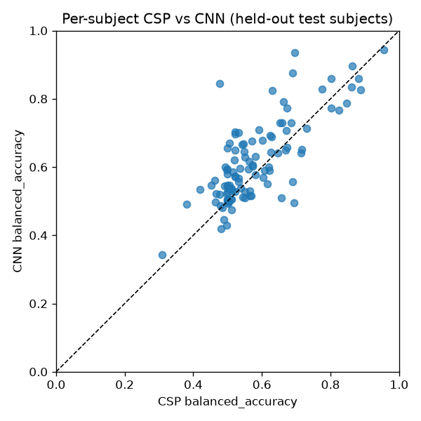
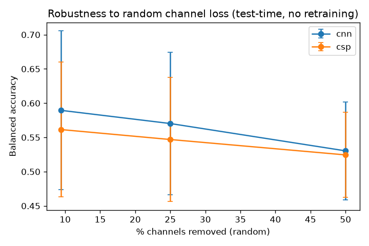

# EEG Motor-Imagery Classification Benchmark

[](https://github.com/adelF-a/eeg-robustness-benchmark/actions/workflows/ci.yml)
[](pyproject.toml)
[](LICENSE)

Classifying **imagined left- versus right-hand movement** from EEG recorded in people
not seen during training. The benchmark compares a classical model with a compact neural
network, then tests their sensitivity to missing channels and the stability of their
channel-level explanations.

**Main finding:** the CNN reached **61.7% balanced accuracy**, compared with **58.1%** for
the classical baseline. This is a modest improvement, not consistently reliable
classification across participants.

[Full results](artifacts/full_v1/report.md) · [Methods and reproduction](docs/METHODS.md) ·
[Experiment provenance](artifacts/full_v1/README.md)

## Problem

Can a model distinguish left- from right-fist imagery in a **new participant**? Does a
compact CNN improve on a common spatial patterns (CSP) + logistic-regression baseline?
How much performance is lost when EEG channels fail, and do explanation rankings remain
similar across training seeds?

This is an offline research benchmark, not a clinical or real-time control system.

## Approach

- **Data:** [PhysioNet EEGMMIDB](https://physionet.org/content/eegmmidb/1.0.0/), imagined
  left/right fist runs 4, 8, and 12; **106 participants, 4,748 trials, 64 channels**.
  Three of 109 requested participants were excluded by the sampling-rate check.
- **Preprocessing:** common-average reference, 7–30 Hz filtering, and 1–4 s post-cue
  windows. Rest events are excluded.
- **Models:** CSP + scaled logistic regression versus an EEGNet-like CNN with
  **2,162 trainable parameters**.
- **Evaluation:** five subject-held-out folds. All trials from a participant stay
  together; no test participant is used for fitting or model selection. CNN training is
  repeated with five seeds per fold.
- **Model selection:** CSP uses three grouped inner folds. CNN early stopping uses one
  grouped validation fold. Both selected models are then refit on all outer-training
  participants before testing.
- **Stress tests and explanations:** shared random/regional channel-loss masks, CSP
  patterns, CNN channel occlusion, integrated gradients, and explanation-stability checks.

The [methods](docs/METHODS.md) specify fitting, normalization, missing-channel imputation,
and explanation cohorts. All fitted statistics use training data, never test participants.

## Results

Balanced accuracy is the average of left-class recall and right-class recall. We average
CNN scores across seeds within each participant, then give every participant equal weight.
The expected chance level for this two-class metric is **50%**.

| Method | Mean subject balanced accuracy | 95% subject-bootstrap CI |
|---|---:|---:|
| CSP + logistic regression | 58.1% | 56.0–60.4% |
| Compact EEGNet-like CNN | 61.7% | 59.3–64.1% |

The paired CNN advantage is **3.5 percentage points** (95% CI: **2.1–5.1**), calculated
before rounding the model means. The CNN performed better for 68 participants, CSP for
37, with one tie. This supports an average improvement within this dataset and protocol,
not universal superiority.

### What the scores mean

- **Left versus right:** CNN recall averaged **63.3% for left imagery** and **60.0% for
  right imagery**, first across seeds and then participants. Many trials were still
  misclassified.
- **Participant variability:** median CNN balanced accuracy was **59.1%**;
  **12 of 106 participants** had seed-averaged scores below 50%.
- **Missing channels:** removing 50% of channels at random reduced balanced accuracy to
  **53.0% for the CNN** and **52.4% for CSP**, close to chance.
- **Explanation stability:** CNN channel-importance rankings had median Spearman
  correlation **0.504** across seeds. Explanations were not consistently reproducible.





The [frozen V1 evidence](artifacts/full_v1/README.md) contains result tables, saved splits,
figures, environment metadata, and checksums. Training ran on a Tesla T4 on 2026-07-28;
the evidence and reports were reviewed on 2026-08-05. The interpretation above uses those
saved results, not a new training run.

## Reproduce

Python 3.10+ is required. From the repository root:

```bash
python3 -m venv .venv
source .venv/bin/activate
python -m pip install -e ".[dev]"
python -m pytest -q
```

Installation needs internet access. Once installed, tests use synthetic data and committed
result files; they require neither a dataset download nor a GPU. GitHub Actions runs lint,
format checks, and tests on Python 3.11 and 3.12.

For a small real-data functional check:

```bash
python -m eeg_benchmark.cli download --config configs/smoke.yaml
python -m eeg_benchmark.cli validate-data --config configs/smoke.yaml
python -m eeg_benchmark.cli run-all --config configs/smoke.yaml
```

This downloads data for five participants and trains small models. Outputs go to
`results_smoke_active/` and `reports_smoke_active/`. These smoke results check execution;
they are not scientific evidence. CPU, CUDA, and Apple MPS are supported.

For the full experiment, individual pipeline stages, and runtime details, see
[Methods and reproduction](docs/METHODS.md). A full run can take hours. The committed
report and figures can be inspected without downloading data or training anything.

## Limitations and next experiment

- One public dataset and one split protocol were evaluated; there is no external-dataset
  replication. Cross-validation folds share training data. The confidence intervals
  describe participant variation conditional on this run, not independent-study uncertainty.
- Classification remains modest and participant-dependent. Channel attributions do not
  establish a physiological mechanism or a causal explanation.
- CSP selected the upper search boundary `C=10` in every fold and `n_components=8` in three
  folds. A wider grid requires a separately specified V2 sensitivity experiment.
- Near-perfect explanation stability under small added noise may reflect a weak perturbation;
  it is not evidence of broad robustness.
- CNN latency was measured on a GPU and CSP latency on a CPU. These measurements do not
  establish an intrinsic speed advantage for either model.

V1 remains frozen. Changes to preprocessing, splits, model selection, or training must be
evaluated as a new experiment rather than replacing the published result.

## Repository structure

| Location | Purpose |
|---|---|
| [`src/eeg_benchmark/`](src/eeg_benchmark/) | Data pipeline, models, training, evaluation, and reporting |
| [`configs/`](configs/) | Full experiment and small functional-check settings |
| [`tests/`](tests/) | Offline checks for fitting, splits, explanations, reporting, and evidence |
| [`artifacts/full_v1/`](artifacts/full_v1/) | Published result tables, figures, saved splits, and provenance |
| [`docs/METHODS.md`](docs/METHODS.md) | Scientific protocol and reproduction instructions |

Raw EEG, trained checkpoints, and generated working outputs are not committed. The evidence
overview distinguishes retained files from the larger artifacts inspected during the audit.

## License and references

Code: [MIT](LICENSE). Project citation: [CITATION.cff](CITATION.cff).

- Dataset: Schalk (2009), [EEG Motor Movement/Imagery Dataset](https://physionet.org/content/eegmmidb/1.0.0/).
- Architecture inspiration: Lawhern et al. (2018), [EEGNet](https://arxiv.org/abs/1611.08024).
  This project uses an EEGNet-like variant, not an exact reproduction of the paper.
- Further dataset and platform references are listed in the [methods](docs/METHODS.md#references).
